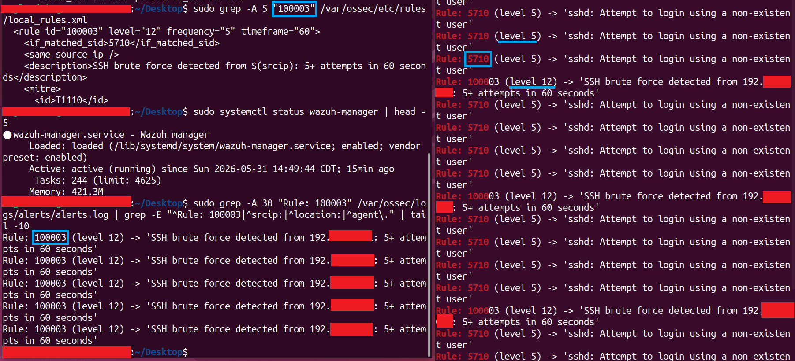

# Lab 1b: SSH Brute Force Detection with Kali, Hydra, and Wazuh

**Project:** P1, Wazuh SIEM Home Lab  
**Phase:** 1b | **Platform:** Hyper-V on Windows 11 Pro (the lab later moved to VirtualBox on new hardware)  
**MITRE ATT&CK:** [T1110 — Brute Force](https://attack.mitre.org/techniques/T1110/), [T1110.001 — Password Guessing](https://attack.mitre.org/techniques/T1110/001/)  
**Cert Alignment:** CySA+ CS0-004, Domain 1 (Security Operations); SC-200  
**Date:** May 2026

---

## Why I Did This One

In [Lab 1](00-LAB-P1-1a.md), I got a Windows agent forwarding failed logons to Wazuh, where one event triggered one alert. That's a good start, but a real brute force attack shows up as a pattern over time, not a single event. So for this one, I wanted to teach myself frequency-based detection: catch an attack because of how many failures happen from the same place in a short window.

It was also my first time running an attacker VM in the lab. I set up Kali, pointed Hydra at the SSH service on my Ubuntu Wazuh manager, and wrote a rule that fires when five failures come from the same source IP within sixty seconds.

## Architecture

```
[Kali Linux VM: Attacker]               [Ubuntu 22.04 VM: SIEM Manager + Target]
  LabInternal static IP      ──────────►  Wazuh Manager v4.14.5-1
                                           LabInternal static IP
                                           sshd (port 22)
  Hydra SSH brute force      ──────────►  Rule 5710 feeds Rule 100003
```

Both VMs sat on the same isolated LabInternal Hyper-V switch with static IPs that I set up for agent-to-manager traffic in Lab 1.

## What I Built

### 1. Getting the Kali VM onto LabInternal

I added a second network adapter to the Kali VM in Hyper-V Manager, assigned it to the LabInternal switch, and gave the new interface a static IP:

```bash
sudo ip addr add <attacker-ip>/24 dev eth1
sudo ip link set eth1 up
```

Then I pinged the Wazuh manager to confirm connectivity before going any further.

One thing I ran into: adding a NIC to a running Hyper-V VM isn't enough on its own. The interface shows `NO-CARRIER` until you explicitly assign the virtual switch in the VM's settings. No amount of IP configuration on the Linux side matters until that Hyper-V step is done.

### 2. Turning the Manager into an SSH Target

The base Wazuh install doesn't need OpenSSH server, so my manager didn't have it. Installing it gave Hydra something real to attack:

```bash
sudo apt install -y openssh-server
sudo systemctl enable --now ssh
```

I confirmed it was listening on `0.0.0.0:22`.

### 3. Writing Rule 100003

Wazuh already ships with SSH rules in `0095-sshd_rules.xml`, including:

- **Rule 5710** (level 5): an SSH login attempt using a non-existent user
- **Rule 5712** (level 10): SSH brute force, 8 failed attempts in 120 seconds from the same source IP

I wrote my own rule in `/var/ossec/etc/rules/local_rules.xml` that fires at a lower threshold and carries explicit MITRE T1110.001 tagging:

```xml
<group name="local,syslog,sshd,">
  <rule id="100003" level="12" frequency="5" timeframe="60">
    <if_matched_sid>5710</if_matched_sid>
    <same_source_ip />
    <description>SSH brute force detected from $(srcip): 5+ attempts in 60 seconds</description>
    <mitre>
      <id>T1110</id>
      <id>T1110.001</id>
    </mitre>
  </rule>
</group>
```

The choices behind it:

- **Rule ID 100003.** It picks up right after rule 100002 from Lab 1, so no collisions.
- **Parent rule 5710.** That's the failed login against a non-existent username, which is exactly what Hydra generates with a made-up login.
- **5 attempts in 60 seconds.** Tighter than the built-in rule 5712 (8 in 120). That's fine in a lab; in production I'd tune it against normal SSH failure rates first.
- **`<same_source_ip />`.** This ties the count to one attacker address. Without it, failures from every source get lumped together and the rule gets a lot noisier.
- **Level 12.** Higher than the built-in 5712 (level 10), so my custom detection stands out.

```bash
sudo systemctl restart wazuh-manager
```

This is the rule as I first wrote it. When I rebuilt the lab on Ubuntu 25.04, failed SSH logins started coming through PAM as a different event, so I had to rework this rule to catch them. That's written up in [P2-1b](00-LAB-P2-1b.md), and the current version lives in [`detection-rules/local_rules.xml`](detection-rules/local_rules.xml).

## What I Detected

From the Kali VM, I ran Hydra against the manager's SSH service:

```bash
hydra -l baduser -p badpass <manager-ip> ssh
```

I ran that six times in quick succession. Each run produced one SSH auth failure, which triggered rule 5710. After the fifth one landed inside the sixty-second window, rule 100003 fired. Here's what showed up in `/var/ossec/logs/alerts/alerts.log`:

```
Rule: 5710 (level 5) -> 'sshd: Attempt to login using a non-existent user'
Rule: 5710 (level 5) -> 'sshd: Attempt to login using a non-existent user'
Rule: 5710 (level 5) -> 'sshd: Attempt to login using a non-existent user'
Rule: 5710 (level 5) -> 'sshd: Attempt to login using a non-existent user'
Rule: 5710 (level 5) -> 'sshd: Attempt to login using a non-existent user'
Rule: 100003 (level 12) -> 'SSH brute force detected from <attacker-ip>: 5+ attempts in 60 seconds'
```

Rule 100003 kept firing with each new set of five attempts.



## What I Took Away

**Two NICs can make the attacker look like someone else.** My Kali VM had eth0 on the Default Switch for internet access and eth1 on LabInternal for lab traffic. Even after I gave eth1 its LabInternal IP, the routing table still preferred eth0 as the default gateway. So Hydra's traffic went out through the Default Switch NAT, and the attacks showed up as coming from my host's LabInternal address instead of the Kali VM's own IP. The detection still fired, since rule 100003 only cares about a consistent source, not which one. But the attribution was wrong, and in a real investigation that matters. The fix would be a static route that forces lab traffic through eth1, or dropping the default gateway from eth0 while doing lab work.

**Frequency rules have to keep count.** Rule 100002 from Lab 1 fires on a single event. Rule 100003 has to track a rolling count per source inside a time window. If an attacker spreads attempts across the window or rotates source IPs, it won't fire. That's a tradeoff of the design, not a flaw, and it's why threshold tuning and single-event rules both still matter.

**A child rule is only as good as its parent.** Rule 100003 only fires if rule 5710 fires first. If 5710 were suppressed or missing, 100003 would stay silent no matter how many SSH failures piled up. That's exactly what happened later when I moved to Ubuntu 25.04 and the parent event changed. Checking that the parent rule actually fires is worth doing before trusting a quiet child rule.

**`NO-CARRIER` on a Hyper-V NIC means the switch isn't connected.** Adding the NIC and assigning it to a switch are two separate steps in Hyper-V, and until the second one is done, nothing leaves the VM.

## Lab Environment

| Component | Details |
|-----------|---------|
| Host | Windows 11 Pro, Hyper-V (May 2026 hardware) |
| SIEM Manager / Target | Ubuntu 22.04 LTS, Wazuh v4.14.5-1, OpenSSH server |
| Attacker VM | Kali Linux, Hydra v9.6, LabInternal static IP |
| Network | Isolated internal Hyper-V switch, static IPs |

## What Came Next

- **[Lab 1c](00-LAB-P1-1c.md):** a tiered Active Directory lab (lab.local forest, Tier 0 DC, Tier 1 jump box), with rule 100002 running on a domain-joined host.
- **[Lab 1d](00-LAB-P1-1d.md):** a two-stage kill chain, brute force escalating to lateral movement, detected by rules 100004 and 100005.
- **[P2-1b](00-LAB-P2-1b.md):** rule 100003 rebuilt for Ubuntu 25.04, plus Wazuh Active Response blocking the attacker automatically.

---

*Part of the [cloud-security-lab-notes](https://github.com/JNewbrey87/cloud-security-lab-notes) portfolio, building toward Cloud Security Analyst and the CySA+ / SC-200 / SC-500 certifications.*
