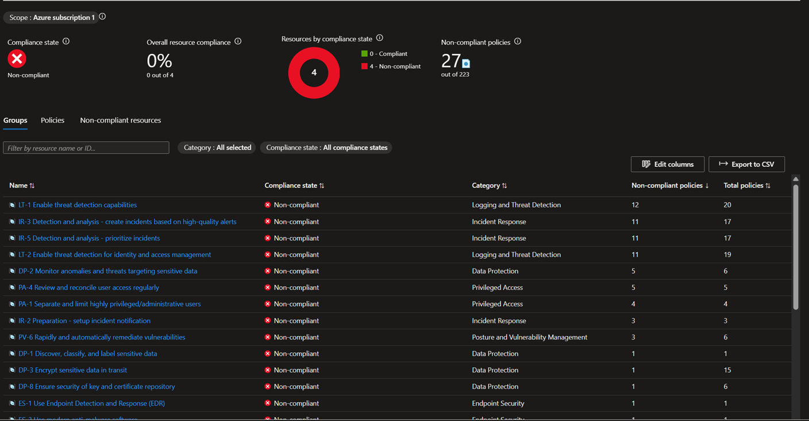
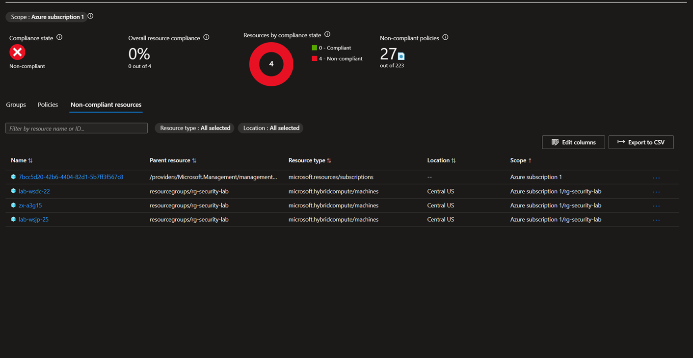

# Lab 2a: Azure Arc Onboarding and an MCSB Baseline for the Lab

**Project:** P2, Azure Integration and Cloud Detection Engineering  
**Phase:** 2-1a | **Platform:** Azure Arc (hybrid), VirtualBox on Windows 11 Pro  
**MITRE ATT&CK:** [T1078 — Valid Accounts](https://attack.mitre.org/techniques/T1078/), [T1562 — Impair Defenses](https://attack.mitre.org/techniques/T1562/) (via MCSB control coverage)  
**Cert Alignment:** CySA+ CS0-004, Domain 2 (Vulnerability Management); SC-200  
**Date:** June 2026  

---

## Why I Did This One

Phase 1 left me with a working on-prem detection stack: four custom Wazuh rules, three agents, and a validated brute-force-to-lateral-movement kill chain. For Phase 2, I wanted to pull that same lab into Azure without moving any of it, so I could start learning the cloud-native security tooling against machines I already understood.

Azure Arc is how you do that. The Arc agent runs on each on-prem machine and registers it in Azure as a managed resource, which makes it a target for Azure Policy, Defender for Cloud, and eventually Sentinel. Standing up cloud resources is familiar territory for me from work, but treating my own on-prem VMs as Azure-managed assets, and then reading their security posture through a benchmark, was the part I wanted the reps on. This lab covers the Arc onboarding, governance tagging, the Microsoft Cloud Security Benchmark (MCSB) baseline, an Entra ID posture check, and one debugging lesson about which Azure view you can actually trust.

> **Update (October 2026):** the `rg-security-lab` resource group described here was later deleted during a separate cloud forensics lab (see [cysa-04](CySA/cysa-04-azure-vm-forensic-snapshot.md)), which removed the Arc registrations and the policy assignments below. Re-onboarding these machines to Arc, in a dedicated resource group this time, is on my list. Everything in this writeup reflects the state during the June 2026 session.

## Architecture

```
[ZX-A3G15: Win 11 Pro host]    [LAB-WSJP-25: Tier 1 Jump Box]    [LAB-WSDC-22: Tier 0 DC]
 Arc agent 001                   Arc agent 002                     Arc agent 003
         |                               |                                 |
         +-------------------------------+---------------------------------+
                                         |
                             [Azure Arc: rg-security-lab, Central US]
                             Resource type: microsoft.hybridcompute/machines
                                         |
                    +--------------------+--------------------+
                    |                                         |
         [Azure Policy]                            [Microsoft Entra ID]
         Guest Configuration prerequisite          Identity Secure Score 68.42%
         MCSB v2 baseline                          Single GA user
         0% compliance (expected baseline)
```

The VMs stayed on the isolated host-only VirtualBox network for the Wazuh work. Arc talks to Azure over each VM's NAT adapter for outbound traffic only, so onboarding doesn't expose the lab machines to the internet.

## What I Built

### 1. Arc Onboarding for All Three Machines

I deployed Arc agent v1.65 to each machine using the onboarding script Azure generates under Arc, Servers, Add a single server. All three joined resource group `rg-security-lab` in Central US.

| Machine | Role | Arc Status |
|---------|------|-----------|
| LAB-WSJP-25 | Tier 1 jump box, Windows Server 2025 | Connected |
| ZX-A3G15 | VirtualBox host, Windows 11 Pro | Connected |
| LAB-WSDC-22 | Tier 0 DC, Windows Server 2022 | Connected |

```powershell
Set-ExecutionPolicy Bypass -Scope Process -Force
.\ArcOnboardingScript.ps1
# a device-code login prompt appears; authenticate as the Azure account owner
```

After sign-in, the Arc service (`himds`, the Hybrid Instance Metadata Service) starts and registers the machine. I confirmed each one showed Connected in the portal.

I onboarded the VirtualBox host itself (ZX-A3G15) on purpose, since it also runs as Wazuh agent 001 and is part of the detection pipeline. Having it in Azure alongside the VMs gives a complete picture of the fleet. It's still permanently off-limits as a lab attack target.

### 2. Governance Tagging

I tagged `rg-security-lab` with `Environment: Lab`, `Owner: JNewbrey`, and `Project: cloud-security-homelab`. Tags set at the resource group level are inherited by everything in the group, so all three machines carry them for filtering, reporting, and cost tracking. It's a small step, but tagging from the start rather than retrofitting it later is the kind of governance hygiene that holds up in an audit.

### 3. MCSB Baseline Policy

I made two policy assignments at the `rg-security-lab` scope:

- **Guest Configuration prerequisite.** Deploys the managed identity and Windows Guest Configuration extension to each Arc machine, which any policy that reads machine configuration needs.
- **"Windows machines should meet requirements of the Azure compute security baseline."** This is MCSB v2, Azure's equivalent of the CIS Benchmarks. It checks each machine against 223 policies across control families like logging, incident response, privileged access, data protection, and endpoint security.

### 4. Entra ID Posture Check

I reviewed the tenant's posture after onboarding. Identity Secure Score was 68.42%, with five free-tier recommendations. The one flagged High was "Do not expire passwords," affecting all users. I left it as-is on purpose, since forcing password expiration on a single-user lab tenant adds friction for no real security benefit. The tenant is Entra ID Free with a single Global Administrator.

## What I Observed

After the policies propagated, the Policy Compliance dashboard showed 0% compliance across all four assessed resources, with 27 non-compliant policies out of 223.



The biggest non-compliant control families:

| Control | Name | Category | Non-compliant / Total |
|---------|------|----------|----------------------|
| IT-1 | Enable threat detection capabilities | Logging and Threat Detection | 12 / 20 |
| IR-1 | Detection and analysis: create incidents | Incident Response | 11 / 17 |
| IR-5 | Detection and analysis: prioritize incidents | Incident Response | 11 / 17 |
| IT-2 | Threat detection for identity and access | Logging and Threat Detection | 11 / 19 |
| DP-2 | Monitor anomalies targeting sensitive data | Data Protection | 5 / 6 |
| PA-4 | Review and reconcile user access regularly | Privileged Access | 5 / 5 |
| PA-1 | Separate and limit highly privileged users | Privileged Access | 4 / 4 |

0% is the right baseline here, not a failure. These machines have no hardening, no logging beyond Wazuh, no Defender for Endpoint, and no Sentinel workspace yet. Every non-compliant policy is a gap to close in later phases.

The four non-compliant resources were the subscription itself plus the three machines, each listed as `microsoft.hybridcompute/machines` in Central US. That resource type is the confirmation that Arc onboarding worked, since it marks them as on-prem machines managed through Arc rather than native Azure VMs.



### The Defender for Cloud View That Lied to Me

Defender for Cloud's Inventory showed 0 assessed resources, which looked like the whole thing had failed. It hadn't. The subscription was in a "Trial expired, Partial" state, which breaks the Inventory UI, but the MCSB assessment was running fine, which I confirmed on the Policy Compliance dashboard. The Inventory view was the broken surface, not the scan.

## What I Took Away

**Check the policy layer, not the Inventory count.** A silent Inventory failure in a partial-trial subscription looks exactly like a failed onboarding or a broken policy. The Policy Compliance view, filtered to the Arc machine resource type, is what told me the scan was actually working. In production, a silent UI failure like that is how you end up with a false sense of security, so verifying at the policy layer is the right instinct.

**The MCSB breakdown shows where the gaps cluster.** IT-1 and IT-2 together are 23 logging and detection policies, almost all non-compliant, and IR-1 and IR-5 add another 34 for incident response. That's by design: MCSB assumes most organizations have a detection-and-response gap more than a firewall gap, so it weighs logging and IR heavily. That told me where to aim Phase 2, which is Sentinel and KQL detection first.

**Tag at setup, not after.** Tagging the resource group before adding machines means everything inherits the tags automatically. Doing it after the fact means chasing down each resource one at a time. The tags are boring; the timing is the point.

**Arc manages on-prem machines without moving or exposing them.** These are VMs on a local VirtualBox host, registered to the Azure control plane through the agent's outbound HTTPS. Azure can evaluate, assess, and eventually ingest logs from them with no inbound connection to the lab. That's the whole value of Arc, and seeing it work on my own machines made it click.

## Lab Environment

| Component | Details |
|-----------|---------|
| VirtualBox Host | ZX-A3G15, Windows 11 Pro, VirtualBox 7 |
| Lab Network | Isolated host-only (192.168.10.0/24, no external exposure) |
| Arc machines | LAB-WSDC-22 (Server 2022), LAB-WSJP-25 (Server 2025), ZX-A3G15 (Windows 11 Pro) |
| Azure resource group | rg-security-lab, Central US (later deleted; see note at top) |
| Arc agent version | v1.65.03439.3010 |
| Entra ID | Free tier, single GA user, Identity Secure Score 68.42% |

## What Came Next

- **[P2-1b](00-LAB-P2-1b.md):** rebuilding SSH brute force detection for Ubuntu 25.04 and adding Wazuh Active Response.
- **[CySA+ lab track](CySA/):** the CS0-004 labs that followed, including the cloud forensic snapshot that reused this Azure tenant.

Still on my list from this one:

- Re-onboard the machines to Arc in a dedicated resource group, after the cysa-04 teardown.
- Microsoft Sentinel: a Log Analytics Workspace and the Windows Security Events connector, to get the Phase 1 kill chain into a cloud SIEM.
- Translate the Wazuh rules (100002, 100004, 100005) into KQL analytic rules in Sentinel.

---

*Part of the [cloud-security-lab-notes](https://github.com/JNewbrey87/cloud-security-lab-notes) portfolio, building toward Cloud Security Analyst and the CySA+ / SC-200 / SC-500 certifications.*
