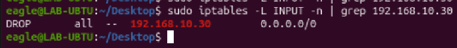
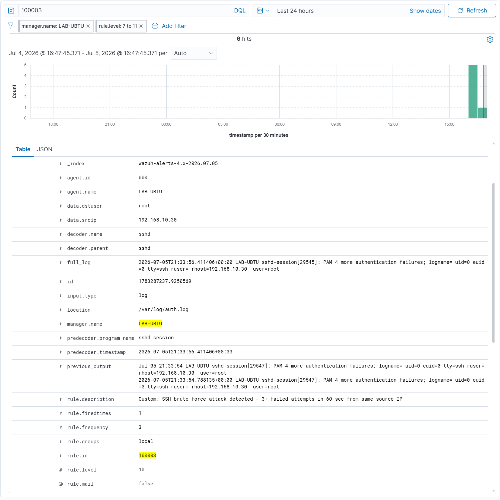

# Lab 2b: Rebuilding SSH Brute Force Detection for Ubuntu 25.04, Plus Active Response

**Project:** P2, Azure Integration and Cloud Detection Engineering  
**Phase:** 2-1b | **Platform:** VirtualBox on Windows 11 Pro (ZX-A3G15)  
**MITRE ATT&CK:** [T1110 — Brute Force](https://attack.mitre.org/techniques/T1110/), [T1110.001 — Password Guessing](https://attack.mitre.org/techniques/T1110/001/), [T1136.001 — Create Account: Local Account](https://attack.mitre.org/techniques/T1136/001/), [T1543.003 — Create or Modify System Process: Windows Service](https://attack.mitre.org/techniques/T1543/003/)  
**Cert Alignment:** CySA+ CS0-004, Domain 1 (Security Operations); SC-200  
**Date:** July 2026  

---

## Why I Did This One

Back in Lab 1b, I built an SSH brute force rule that worked on Ubuntu 22.04. When I rebuilt the lab on new hardware with a newer Ubuntu, that rule quietly stopped firing. Nothing errored. Hydra ran, and Wazuh just sat there. A detection that silently dies is worse than no detection, because you think you're covered, so I wanted to track down exactly why it broke and fix it. Then I wanted to go one step further than I had before and have Wazuh actually respond to the attack on its own, not just alert on it.

## Architecture

```
[LAB-KALI: Attacker]                    [LAB-UBTU: Wazuh Manager + SSH Target]
  192.168.10.30                           192.168.10.10, Ubuntu 25.04
  SSH brute force         ──────────────► sshd-session → PAM → rule 2502
                                               │
                                          Rule 100009 (single failure, rhost= field)
                                               │
                                          Rule 100003 (3+ hits in 60s, same IP)
                                               │
                                       Active Response: firewall-drop, 180s
  LAB-KALI BLOCKED        ◄────────────── iptables DROP → 192.168.10.30
```

Everything runs on the isolated host-only VirtualBox network. The 192.168.10.x addresses aren't reachable from outside.

## What I Built

### 1. Tracking Down Why the Rule Went Silent

The symptom was that an SSH brute force produced no Wazuh alerts at all. Two separate things were stacking up.

**PerSourcePenalties.** Ubuntu 25.04's sshd turns on connection-rate penalties by default. Once a source IP racks up failed connections, sshd starts rejecting new connections at the transport layer before authentication even happens. No auth attempt means no log, which means nothing for Wazuh to catch. I turned it off for the lab:

```
# /etc/ssh/sshd_config on LAB-UBTU
PerSourcePenalties no
```

```bash
sudo systemctl restart ssh
```

**The PAM log path.** With that disabled, the attempts reached authentication and started logging, but they still didn't match my rule. Ubuntu 25.04 uses `sshd-session`, which routes failures through PAM, and those events don't decode the way the old `sshd` ones did. To find what they actually hit, I pasted a real failure line from `/var/log/auth.log` into `wazuh-logtest`:

```bash
sudo /var/ossec/bin/wazuh-logtest
```

It resolved to **rule 2502** ("User missed the password more than one time"), not rules 5700 or 5710 that my old rule was built on. That was the answer: my parent rule had to change from 5700 to 2502.

### 2. Rule 100009: Catching the Single-Failure PAM Format

Some of the 25.04 PAM failures come through as a single-failure event carrying a `rhost=` field with the source IP, which maps to rule 5711. I added rule 100009 to capture that case as a supplement to rule 2502:

```xml
<rule id="100009" level="5">
  <if_sid>5711</if_sid>
  <match>rhost=</match>
  <description>Custom: SSH auth failure with remote host attribution (PAM format, sshd-session, Ubuntu 25.04)</description>
  <mitre>
    <id>T1110</id>
  </mitre>
</rule>
```

### 3. Rule 100003: Rebuilt for the PAM Path

I rewrote rule 100003 to use rule 2502 as its parent, and dropped the threshold to three attempts in sixty seconds, which is fine in a lab where there's no legitimate SSH traffic to cause false positives:

```xml
<rule id="100003" level="10" frequency="3" timeframe="60">
  <if_matched_sid>2502</if_matched_sid>
  <same_source_ip />
  <description>Custom: SSH brute force detected: 3+ PAM auth failures in 60 sec from same source IP</description>
  <mitre>
    <id>T1110</id>
    <id>T1110.001</id>
  </mitre>
</rule>
```

### 4. Three More Windows Rules for Persistence and Lockout

While I was in the rules file, I added three Windows rules that extend my coverage past brute force into persistence, complementing the lateral-movement rules from Lab 1d:

```xml
<!-- Rule 100006: new local account created (Event 4720), T1136.001 -->
<rule id="100006" level="12">
  <if_group>windows</if_group>
  <field name="win.system.eventID">^4720$</field>
  <description>Custom: Windows user account created (Event 4720) - possible persistence via local account</description>
  <mitre><id>T1136.001</id></mitre>
</rule>

<!-- Rule 100007: new service installed (Event 7045), T1543.003 -->
<rule id="100007" level="12">
  <if_group>windows</if_group>
  <field name="win.system.eventID">^7045$</field>
  <description>Custom: New Windows service installed (Event 7045) - possible persistence or privilege escalation</description>
  <mitre><id>T1543.003</id></mitre>
</rule>

<!-- Rule 100008: account lockout (Event 4740), T1110 -->
<rule id="100008" level="10">
  <if_group>windows</if_group>
  <field name="win.system.eventID">^4740$</field>
  <description>Custom: Windows account lockout detected (Event 4740) - brute force indicator</description>
  <mitre><id>T1110</id></mitre>
</rule>
```

### 5. Active Response: Blocking the Attacker Automatically

This was the new piece for me. Wazuh's Active Response runs a script when a rule fires, and the built-in `firewall-drop` adds an iptables DROP for the offending IP and pulls it back out after a timeout. I wired it to rule 100003:

```xml
<!-- /var/ossec/etc/ossec.conf, inside <ossec_config> -->
<active-response>
  <command>firewall-drop</command>
  <location>local</location>
  <rules_id>100003</rules_id>
  <timeout>180</timeout>
</active-response>
```

```bash
sudo systemctl restart wazuh-manager
```

So when rule 100003 fires, Wazuh drops the attacker's IP for 180 seconds, then restores it, with no action from me.

## What I Detected

From the Kali VM, I ran an SSH brute force against the Ubuntu box. After three PAM auth failures from 192.168.10.30 inside the sixty-second window, rule 100003 fired in the dashboard.



Right after it fired, Active Response added the firewall block. I confirmed it on the Ubuntu box:

```bash
sudo iptables -L -n | grep 192.168.10.30
# DROP  all  --  192.168.10.30  0.0.0.0/0
```



After 180 seconds the block cleared on its own.

## What I Took Away

**A detection can die silently when the platform changes under it.** On Ubuntu 22.04, sshd wrote failures in the format my rule expected. On 25.04, `sshd-session` hands them to PAM, which decodes as rule 2502 instead. There was no error and no warning, just zero alerts during an attack. `wazuh-logtest` is the tool for this: paste a real log line, watch where it lands, and build the rule around what actually fires rather than what fired on the last OS.

**PerSourcePenalties is a real defense that also hides the attack from the SIEM.** It drops repeated connections before authentication, so there's nothing to log. Turning it off makes sense for a detection lab, but it's worth understanding that it isn't a misconfiguration, it's a hardening feature. In production with it on, you'd lean on network-layer or firewall-log detection to catch early brute force, since the host won't log it.

**Automated response is powerful and worth being careful with.** The firewall-drop fires within seconds, no SOAR and no analyst needed. In a lab, a false positive just blocks my attacker VM for three minutes. In production, auto-blocking at the SIEM can cut off legitimate traffic, and the risk scales with how precise the rule is. The usual production posture is to alert and enrich, then block downstream after someone confirms it. I wanted to build the capability and understand where the judgment call lives.

**Detection rules need maintenance, not just creation.** "The rule exists" and "the rule fires" are two different claims. The only reason I caught this gap is that I re-ran the attack after moving platforms. Periodically re-testing detections against a real attack is how you keep "exists" and "fires" from drifting apart.

## Lab Environment

| Component | Details |
|-----------|---------|
| VirtualBox Host | ZX-A3G15, Windows 11 Pro, VirtualBox 7 |
| SIEM Manager / Target | LAB-UBTU, Ubuntu 25.04, Wazuh v4.14.5-1, OpenSSH server |
| Attacker VM | LAB-KALI, 192.168.10.30, Hydra |
| Network | Isolated host-only VirtualBox network (192.168.10.0/24), no external exposure |
| Active Response | firewall-drop built-in script, 180s auto-expiring timeout |

## What Came Next

- **[CySA+ lab track](CySA/):** the CS0-004 labs that followed, picking up vulnerability management, memory forensics, cloud evidence acquisition, and a full incident response cycle on these same machines.
- All eight custom rules from the P1 and P2 series, including the ones added here, are collected in [`detection-rules/local_rules.xml`](detection-rules/local_rules.xml).

Still on my list:

- Microsoft Sentinel: translate the Wazuh rules into KQL analytic rules once a Log Analytics Workspace is up, so the same detections run in a cloud SIEM.

---

*Part of the [cloud-security-lab-notes](https://github.com/JNewbrey87/cloud-security-lab-notes) portfolio, building toward Cloud Security Analyst and the CySA+ / SC-200 / SC-500 certifications.*
