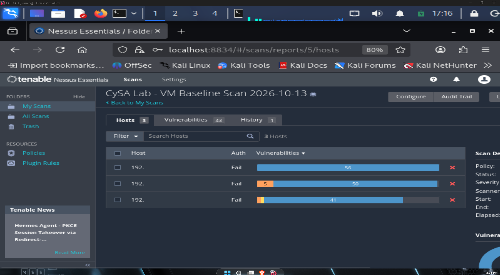
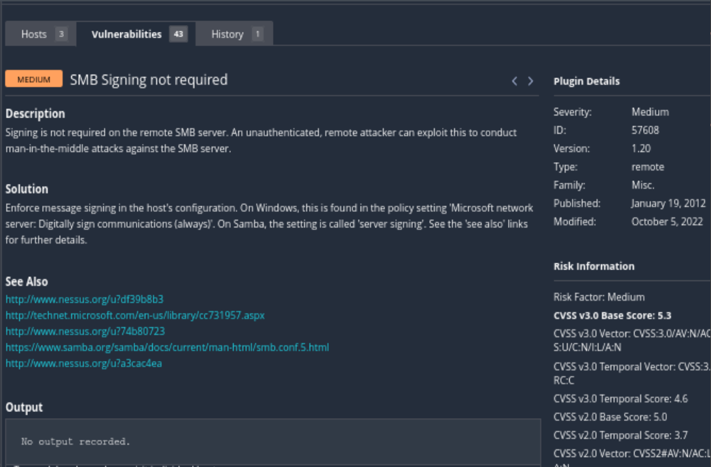

# Vulnerability Management Baseline: Nessus Scan of the Lab Environment

**Project:** CySA+ Lab Track, Vulnerability Management  
**Session:** VM-01 | **Platform:** VirtualBox on Windows 11 Pro, isolated host-only network  
**Scanner:** Nessus Essentials, uncredentialed Basic Network Scan  
**MITRE ATT&CK:** [T1557.001 — Adversary-in-the-Middle: LLMNR/NBT-NS Poisoning and SMB Relay](https://attack.mitre.org/techniques/T1557/001/)  
**Cert Alignment:** CySA+ CS0-004, Vulnerability Management domain (objectives 2.1 through 2.4)  
**Date:** October 2026

---

## Scenario

My home lab was built for detection engineering: a Wazuh SIEM with eight custom rules and a validated kill chain across a tiered Active Directory environment. That is strong coverage of the Security Operations domain, but it left a gap. CySA+ CS0-004 weights Vulnerability Management at 26% of the exam, and I had no scanner, no scan-to-prioritization-to-remediation workflow, and no CVSS reps against real findings. This session closes the front of that gap by running a baseline vulnerability scan against the machines I already operate, then turning the raw output into a prioritized, context-aware remediation plan.

The point of the exercise is not the scan itself; a scanner is easy to run. The point is the workflow after the scan: separating signal from informational noise, re-scoring findings against what each asset is actually worth, and producing a remediation plan someone could act on.

## Architecture

```
[Nessus Essentials]  ──uncredentialed──►  [LAB-WSDC-22]  Tier 0 Domain Controller   192.168.10.50
  Basic Network Scan                       [LAB-WSJP-25]  Tier 1 Jump Box            192.168.10.60
                                           [LAB-UBTU]     Wazuh Manager              192.168.10.10
```

All hosts sit on an isolated host-only VirtualBox network with no external exposure. The scan was run from a host on that same segment, so it measures what a network-adjacent attacker inside the lab perimeter would see.

## What I Ran

Nessus Essentials, Basic Network Scan policy, no credentials supplied. An uncredentialed scan is a deliberate starting point, not a limitation I overlooked. It assesses only the externally visible attack surface: open ports, service banners, protocol behavior, and configuration flags that are detectable without logging in. All three hosts returned `Auth: Fail`, confirming no credentialed assessment occurred, so every result here reflects the external exposure baseline.

A credentialed scan would examine installed software versions, registry settings, and local policy from the inside, and it would produce a substantially higher finding count. Running the uncredentialed pass first establishes the baseline an outside attacker sees; the credentialed pass (planned next, see Up Next) then shows how much more is visible once you are inside. Knowing the difference between those two pictures is itself part of the Vulnerability Management objective.

## What the Scan Returned

The scan completed in fifteen minutes, and all three hosts returned `Auth: Fail` as expected for an uncredentialed pass.

| Host | Role | IP | Findings | Medium | Info |
|------|------|----|----------|--------|------|
| LAB-WSDC-22 | Tier 0 Domain Controller | 192.168.10.50 | 56 | none confirmed | 56 |
| LAB-WSJP-25 | Tier 1 Jump Box | 192.168.10.60 | 55 | 5 | 50 |
| LAB-UBTU | Wazuh Manager | 192.168.10.10 | 42 | 1 | 41 |

Those per-host totals sum to 153, but that number overcounts: the same plugin firing on three hosts shows up three times. Deduplicated, the scan found **43 distinct vulnerabilities** across the environment, which is the figure Nessus reports on its Vulnerabilities tab. The gap between 153 and 43 is worth internalizing on its own; per-host findings and unique vulnerabilities are different units, and reporting the wrong one either inflates the problem or hides shared exposure.

Almost all of that is informational service enumeration, the scanner describing what it sees rather than flagging a problem. Setting the noise aside, the scan reduced to **one confirmed, actionable finding**: SMB signing not enforced on the jump box. The other Medium plugin groups (five on the jump box, one on the Wazuh manager) were not individually enumerated in this pass, so I am treating one finding as actionable and the rest as unverified until I have drilled into each. The domain controller showed no Medium findings at all from the uncredentialed view, which given its criticality is a reason to scan it with credentials, not a clean bill of health.

No Critical or High findings appeared on any host. That is consistent with current patch state rather than an absence of vulnerability history: both Windows Servers received the October 2026 cumulative updates (KB5126646, KB5126655) before scanning, which clears the most severe known CVEs from an uncredentialed view.

## The Actionable Finding: SMB Signing Not Required

| Field | Value |
|-------|-------|
| Plugin ID | 57608 |
| Severity | Medium |
| CVSS v3 Base | 5.3 |
| CVSS v3 Vector | AV:N/AC:L/PR:N/UI:N/S:U/C:N/I:L/A:N |
| Temporal Score | 4.6 |
| Affected Host | LAB-WSJP-25 (192.168.10.60), the jump box |
| Port | 445/tcp (CIFS) |
| Exploit Available | Yes, publicly available |

SMB signing is a cryptographic control that verifies SMB packets come from the authenticated source and have not been altered in transit. When signing is not required, an attacker positioned on the network can intercept SMB authentication traffic and relay NTLM credentials to authenticate to other systems without ever cracking a password. This is the attack the Responder toolkit automates, and it is a standard lateral movement technique (MITRE T1557.001).

The vector matters: `AV:N` means network-exploitable by any host that can reach port 445, not just hosts on the same local segment. On a flat lab network, that is every host with a route to the jump box. And the finding is on the jump box specifically, which is the one machine whose entire purpose is to broker privileged administrative sessions. That context is what turns a mid-tier base score into something worth fixing first, which is the next section.

## Environmental Re-Scoring

A CVSS Base Score is context-free by design; it describes the vulnerability, not what it would cost *this* organization. The Vulnerability Management workflow is where you add that context, by weighting each asset's Confidentiality, Integrity, and Availability requirements and letting those produce an Environmental Score that reflects real risk. I scored each lab asset deliberately rather than accepting the base numbers.

**LAB-WSDC-22, the Domain Controller (Tier 0).** Confidentiality High: it holds every domain credential hash, Kerberos ticket, and GPO. Integrity High: silent modification of AD objects compromises the whole domain. Availability High: domain authentication fails network-wide without it. CIA weight High/High/High. No actionable finding surfaced here on the uncredentialed pass, which given the asset's criticality is a reason to escalate to a credentialed scan, not a reason to relax.

**LAB-WSJP-25, the Jump Box (Tier 1).** Confidentiality High and Integrity High: privileged sessions and administrative credentials flow through it, and a compromise hands an attacker a trusted launch point with valid admin credentials. Availability Medium: administrative access has alternate paths. CIA weight High/High/Medium. The SMB signing finding impacts Integrity (`I:L` in the vector), and with the jump box's Integrity Requirement set to High, the Environmental Score rises above the 5.3 Base. This is why the finding is remediated first despite its unremarkable base number.

**LAB-UBTU, the Wazuh Manager (detection engine).** Confidentiality Medium: the data is internal security telemetry, operationally sensitive rather than regulated. Integrity High: tampering with detection rules or log data blinds the SOC across every monitored host. Availability High: if Wazuh is down, all eight custom detection rules (100002 through 100009) stop firing and the lab goes dark. CIA weight Medium/High/High. One Medium finding was visible here but not captured in full detail this run; it needs drill-down.

The takeaway is the whole reason the exercise exists: the single highest-priority item is a 5.3 Base Score finding, and it ranks first only because environmental context elevated it. A prioritization process that stopped at the base number would have mis-ranked the most important thing in the scan.





## Remediation Plan

**1. Enforce SMB signing on the jump box (immediate, no downtime).** This is a policy change, not a patch. Via Group Policy:

```
Computer Configuration → Windows Settings → Security Settings →
Local Policies → Security Options →
  Microsoft network server: Digitally sign communications (always) → Enabled
  Microsoft network client: Digitally sign communications (always) → Enabled
```

Or directly via PowerShell:

```powershell
Set-SmbServerConfiguration -RequireSecuritySignature $true -Force
Set-SmbClientConfiguration -RequireSecuritySignature $true -Force
```

Verification: re-run the scan; plugin 57608 should no longer appear on the jump box.

**2. Run a credentialed scan against the Domain Controller (high priority, next session).** The DC returned 56 plugin outputs uncredentialed, but that view cannot assess patch level, registry configuration, Kerberos settings, or installed-software CVEs. For a Tier 0 asset weighted High/High/High, an uncredentialed baseline is not an acceptable risk picture on its own. Add a local administrator credential to the scan policy and re-run.

**3. Enumerate the remaining Medium groups (follow-on).** The five Medium plugin groups on the jump box and the one on the Wazuh manager were not individually resolved in this pass. Each needs host-level drill-down so any additional actionable findings land in the remediation tracker rather than hiding inside a summary count.

## Verification

| Action | Method | Expected result |
|--------|--------|-----------------|
| SMB signing remediated | Re-run scan, check for plugin 57608 on .60 | Not present |
| DC credentialed scan | Add credentials to policy, re-run against .50 | Higher count; actionable CVEs visible |
| Remaining Medium groups enumerated | Host-level drill-down per host | Full finding list documented |
| Wazuh still healthy | `sudo systemctl status wazuh-manager` on .10 | Active (running) |

## What I Learned

**An uncredentialed scan measures the perimeter, not the patch state.** The clean Critical/High result is reassuring but partial; it says an outside attacker sees little low-hanging fruit, not that the hosts are well-configured internally. Treating an uncredentialed baseline as a full assessment is a classic way to under-count risk, especially on the asset that matters most. The honest output of this pass is "here is the external exposure, and here is what we still cannot see."

**Base score alone is not prioritization.** The finding that ranked first carries a 5.3 base, and it earned its priority from two context layers the base number omits: a Temporal score of 4.6 driven by a publicly available exploit, and an Environmental adjustment driven by the jump box's High Integrity Requirement. The same scan surfaced the inverse case, a Low-severity finding (CVSS 2.1) carrying an EPSS of 0.32, roughly a 32% modeled probability of exploitation within thirty days. A Low base score with a high EPSS is exactly the kind of item a base-score-only process waves through. Temporal, EPSS, and environmental context each move the ranking, and a defensible prioritization uses all of them.

**The finding ties back to my detection work.** SMB relay is not an abstract checkbox here; it is the lateral movement path my existing kill-chain lab already instruments. Rules 100004 and 100005 detect explicit credential use and failed network logons arriving at the Tier 0 DC, which is the arrival side of exactly this technique. Enforcing SMB signing closes the vulnerability; the detection rules catch the attempt if it is ever tried. Vulnerability management and detection engineering are the same problem viewed from two ends.

**The session doubled as targeted study.** Turning a scan into a write-up surfaced concrete follow-up topics worth deliberate reps: NTLM relay mechanics and the Responder workflow, the order of volatility for evidence capture, and the distinctions between SAST, DAST, IAST, and SCA. Running the lab as both practice and study is the design goal of this track; Reporting is 16% of the exam, and writing the finding up is the reporting rep.

## Lab Environment

| Component | Details |
|-----------|---------|
| Scanner | Nessus Essentials, Basic Network Scan, uncredentialed |
| Targets | LAB-WSDC-22 (Server 2022 DC), LAB-WSJP-25 (Server 2025 jump box), LAB-UBTU (Ubuntu, Wazuh manager) |
| Host | VirtualBox on Windows 11 Pro; isolated host-only network (192.168.10.0/24) |
| Patch state | October 2026 cumulative updates (KB5126646, KB5126655) applied to both Windows Servers pre-scan |

## Up Next

- **Credentialed scan of the Domain Controller:** expose the internal configuration and patch-level findings an uncredentialed pass cannot see on the lab's most critical asset.
- **Remediation verification:** enforce SMB signing on the jump box and re-scan to confirm plugin 57608 clears.
- **Drill down the MIXED and Medium groups** on both Windows Servers and document anything actionable.
- **Incident Response session (next CySA+ track lab):** replay the kill chain against these VMs and run a full IR cycle on the existing Wazuh detections, moving from the Vulnerability Management domain into Incident Response and Management.

---

*Part of the [cloud-security-lab-notes](https://github.com/JNewbrey87/cloud-security-lab-notes) portfolio, building toward Cloud Security Analyst and the CySA+ / SC-200 / SC-500 certifications.*
